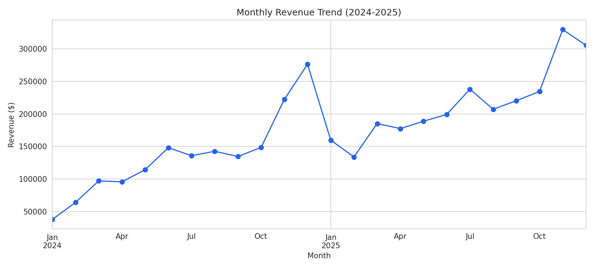
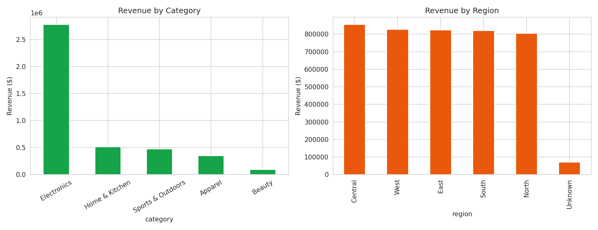
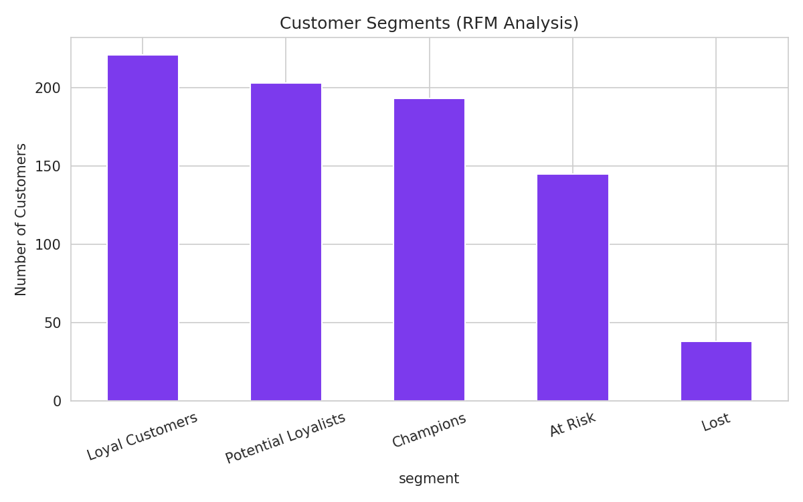

# Sales Data Analysis (Python)

An end-to-end sales analytics project that goes beyond basic charting:
data cleaning, KPI reporting, seasonality analysis, and customer
segmentation using RFM (Recency, Frequency, Monetary) analysis — the
same technique used by real marketing/analytics teams to identify
high-value customers.

## Business questions answered

1. What's our total revenue, order volume, and average order value?
2. How does revenue trend over time, and is there seasonality we should
   plan inventory/marketing around?
3. Which product categories and regions are underperforming?
4. Who are our most valuable customers, and what share of revenue do
   they represent?

## Key findings

- Revenue shows clear **holiday seasonality**, peaking in Nov/Dec each
  year, with a **year-over-year upward trend**.
- **Electronics** is the strongest category by revenue; **Beauty** is
  the weakest and may need a pricing or marketing review.
- RFM segmentation shows the **"Champions" segment** (customers who buy
  often, recently, and spend the most) makes up a minority of the
  customer base but drives roughly a third of total revenue — a classic
  80/20 pattern. This group should be prioritized for retention and
  loyalty campaigns, while the "At Risk" and "Lost" segments are
  candidates for win-back campaigns.
   
   
   
  
Full console output of every metric is saved to `visuals/insights.txt`
after running the analysis.

## Project structure

```
sales-data-analysis/
├── src/
│   ├── generate_data.py   # builds the synthetic transaction dataset
│   └── analysis.py        # cleaning, KPIs, trends, RFM segmentation
├── data/
│   └── sales_data.csv     # generated dataset (~15,000 transactions)
├── visuals/
│   ├── monthly_revenue_trend.png
│   ├── category_region_breakdown.png
│   ├── rfm_customer_segments.png
│   └── insights.txt
└── requirements.txt
```

## How to run it

```bash
pip install -r requirements.txt
cd src
python generate_data.py   # creates data/sales_data.csv
python analysis.py        # cleans data, runs analysis, saves charts
```

## Tech stack

Python, pandas, NumPy, matplotlib, seaborn

## About the data

The dataset is synthetically generated to simulate 2 years of retail
transactions (~15,000 orders, 800 customers, 5 categories, 5 regions)
with realistic seasonality and intentional data-quality issues (nulls,
duplicates) — so the cleaning step in `analysis.py` reflects real
messy-data handling rather than working with a pre-cleaned toy file.

## Possible next steps

- Build an interactive dashboard on top of this (Power BI / Streamlit)
- Add a cohort retention analysis
- Add a simple demand-forecasting model for next quarter's revenue
